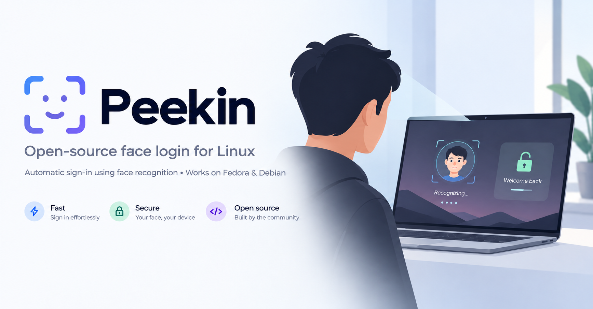

# PeekIn

**Look. Recognize. Unlock.** Face authentication for Linux, built with Rust,
OpenCV and GTK4.



Use your camera to authenticate for `sudo`, the GNOME login screen and the
lock screen. If recognition fails, you can still use your password.

## What you get

- Face enrollment, camera selection and recognition tests in one app.
- Optional head-turn checks and configurable security levels.
- Support for regular webcams and compatible infrared cameras.
- Optional automatic screen locking when you walk away.
- Local processing: your face data never goes to the cloud.
- Encrypted face models, using a TPM when available or a local host key.
- An interface available in eight languages.

## Install

Download the package for your system from
[Releases](https://github.com/christosdaggas/PeekIn/releases).
Use the main `peekin` package; debug packages are only needed for diagnosing crashes.

### Fedora — RPM

In the folder containing the downloaded RPM:

```sh
sudo dnf install ./peekin-[0-9]*.rpm
sudo peekin doctor
```

### Debian 13 — amd64

In the folder containing the downloaded DEB:

```sh
sudo apt install ./peekin_*_amd64.deb
sudo peekin doctor
```

Login and lock-screen integration require GNOME/GDM and an accessible camera.
The installer configures supported PAM layouts; `peekin doctor` reports any
setup problems. Unsupported layouts are left unchanged.

## Start using it

1. Open **PeekIn** from your applications.
2. Select your camera and add your face.
3. Use **Test** to check recognition, then choose where face login is enabled.
4. Look at the camera when authenticating and follow any head-turn instructions.

Settings are also stored in `/etc/peekin/config.ini`. For troubleshooting, run
`sudo peekin doctor`; for command-line help, run `peekin --help` or `man peekin`.

## Security and privacy

Face login is a convenience, not a guarantee of password-level security.
Head-turn checks help against still photos but do not reliably stop video
replays, masks or look-alikes. Use the **Secure** setting for stricter matching
and keep a strong password. Face authentication is never allowed over SSH.

Without a TPM, the encryption key is on the same disk as the encrypted face
models, so it does not protect against a full disk copy. Use full-disk encryption
for that protection. See [recognition measurements](docs/THRESHOLDS.md) and
[security reporting](SECURITY.md) for more information.

## Build from source

Requires **Rust 1.92+**. Build packages on the distribution you intend to use.

**Fedora:**

```sh
sudo dnf install rpm-build rpmdevtools curl 'dnf-command(builddep)'
sudo dnf builddep packaging/peekin.spec
packaging/build-rpm.sh
```

**Debian 13:**

```sh
sudo apt install build-essential pkg-config dpkg-dev gettext clang libclang-dev \
    libopencv-dev libpam0g-dev libgtk-4-dev libadwaita-1-dev
packaging/build-deb.sh
```

Packages are written to `dist/rpm/` or `dist/deb/`.
See [CONTRIBUTING.md](CONTRIBUTING.md) for development and testing.

## Uninstall

Run `sudo dnf remove peekin` on Fedora or `sudo apt remove peekin` on Debian.
Package removal removes its PAM integration; settings and enrolled faces are retained.

## About

Made by [Christos A. Daggas](https://chrisdaggas.com) · <info@chrisdaggas.com>.
Inspired by Howdy and Windows Hello.

[MIT license](LICENSE). The SFace model is licensed under Apache-2.0.
