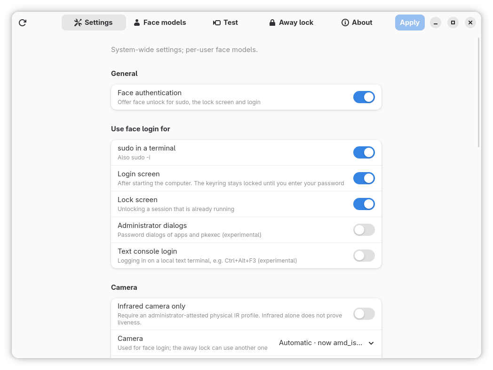

<p align="center">
  
</p>

<h1 align="center">PeekIn</h1>

<p align="center">
  <b>Look. Recognize. Unlock.</b><br>
  Face authentication for Linux.
</p>

---

Typing your password dozens of times a day gets old. With **PeekIn** you just
look at your camera, and your Linux machine knows it's you: `sudo` in the
terminal, the GNOME lock screen and the login screen all open with a glance.

Your password always keeps working. If the camera can't see you, if it's too
dark or if anything goes wrong, PeekIn steps aside and asks for the password
as usual.

## Why PeekIn

- **Unlock with a glance.** Look at the camera for `sudo`, the lock screen or
  the login screen. No extra hardware needed: a regular webcam works, and
  infrared cameras are supported too.
- **Hard to fool with a photo.** After it recognises you, PeekIn asks for a
  short random sequence of head turns (for example LEFT, RIGHT, LEFT). A
  printed photo or a picture on a phone can't follow instructions.
- **Your face stays on your computer.** Nothing goes to the cloud. Face data
  is encrypted with your computer's TPM chip, so a copied disk or a backup is
  useless to anyone else. Without a TPM the key is a file on the same disk: a
  backup that leaves out `/var/lib/systemd/credential.secret` is still
  protected, a full copy of the disk is not (full-disk encryption covers that).
- **You decide where it works.** Turn face login on or off separately for
  `sudo`, the login screen, the lock screen, administrator dialogs and the text
  console. It never works over SSH.
- **Locks when you walk away.** The optional Away lock locks your screen when
  you leave your desk, and PeekIn tells you when someone tried to unlock it
  while you were gone.
- **Stops guessing.** After a few rejected faces in a row, face login pauses
  until you use your password.
- **Brightens up in the dark.** In a dim room PeekIn briefly turns up the
  laptop screen so the camera can see your face.
- **Pick your cameras.** Laptop with several cameras? Choose one for face
  login and another for the Away lock.
- **A friendly app.** Add your face with a live preview, test recognition,
  see a history of every attempt and change every setting without editing a
  file. It speaks English and Greek.
- **Built for Fedora.** One RPM sets up PAM, SELinux and the system services
  for you, and `dnf remove` undoes those changes.

## How it works

1. **Add your face.** Open the PeekIn app and look at the camera for a few
   seconds. You can add more than one face model, for example with and without
   glasses.
2. **Look at the camera.** When you run `sudo` or unlock your screen, PeekIn
   checks the camera for a moment.
3. **Turn your head when asked.** Follow the on-screen head turns, and you're
   in. You can switch this check off if you prefer speed over protection.

Under the hood PeekIn is written in Rust and uses OpenCV's YuNet face detector
and SFace face recognizer, running entirely on your own computer.

## Get started

On Fedora, build and install the RPM:

```sh
sudo dnf install rpm-build rpmdevtools curl 'dnf-command(builddep)'
sudo dnf builddep packaging/peekin.spec
packaging/build-rpm.sh
sudo dnf install dist/rpm/peekin-[0-9]*.rpm
sudo peekin doctor
```

Then open **PeekIn** from your applications and add your face. That's it.

`sudo peekin doctor` checks the whole installation and tells you how to fix
anything that is missing.

## Be aware

PeekIn is a convenience, not a replacement for your password. The head-turn
check stops photos, a still picture on a phone and an ordinary video of you.
It does not stop a video of you turning your head, cut to follow the turns
asked for or simply replayed when the same turns come up again: there are
only 8 possible sequences, and the whole sequence is shown before the scan
starts. A 3D mask or a live video feed can get through too, and a stranger
who looks enough like you can simply do the head turns. An approved infrared
camera, the Secure level and the limit on failed attempts help;
[Security](#security) below explains what each one does. Keep a strong
password.

> While functional, it may contain bugs or security issues. Use at your own risk.
>
> No Warranty: This software is provided "AS IS" without warranty of any kind, express or implied. See the LICENSE file for full details.

## Author

Made by Christos A. Daggas · <info@chrisdaggas.com> · <https://chrisdaggas.com>

Inspired by Howdy and Windows Hello.

---

## Technical documentation

Everything below is for administrators and developers.

### Components

- `pam_peekin.so` (`peekin-pam`): PAM module. Runs
  `peekin-compare` with a hard deadline and bounded reap, so camera
  failures fall through to the
  password when configured as `sufficient`.
- `peekin-compare` (`peekin-vision`): camera capture and face
  recognition.
- `peekin` (`peekin-cli`): root-oriented `add`, `test`, `list`, `clear`,
  `remove`, `disable`, `set`, `config`, `cameras`, `doctor`, `version`.
- `peekin-settings`: GTK4 + libadwaita settings app with settings,
  face models (list/remove, and add with a live camera preview) and a
  visual recognition test. It runs as the logged-in user. A separate
  `peekin-helper` exposes only typed metadata/settings/enroll/remove/test
  operations. Polkit uses separate actions; settings, enrollment and removal
  always require fresh administrator authorization. The helper derives the
  target account from `PKEXEC_UID` and accepts no user or path override.

Not implemented: photos of successful logins (`save_successful`, ignored),
rubberstamps (a config that enables them disables face login rather than
skipping them), password-prompt workarounds (only `workaround = off`: the scan
runs before the password prompt).

### Layout

- `crates/peekin-core/`: config, paths, model store, the scan loop
  (`compare.rs`) and enrollment (`enroll.rs`) behind the `FaceSource` trait.
  No native dependencies; the PAM module links it.
- `crates/peekin-vision/`: OpenCV implementation of `FaceSource`, plus
  `peekin-compare`.
- `crates/peekin-pam/`: `pam_peekin.so` and `examples/pam-harness.rs`.
- `crates/peekin-cli/`: the `peekin` command, `peekin-helper` and
  `examples/benchmark.rs`.
- `crates/peekin-settings/`: the settings app.
- `data/`: default `config.ini`, `fetch-models.sh`, polkit policy, desktop
  entry, icon.
- `data/systemd/`: the boot and session services and their presets.
- `packaging/`: RPM spec, build script, `system-setup`, SELinux module.
- `po/`: translations. `docs/`: thresholds and COPR notes.
- `dist/rpm/`: the RPMs `packaging/build-rpm.sh` builds (not in git).

### Build

Rust 1.92 or newer is required (the locked gtk4-rs crates declare it).

```sh
sudo dnf install cargo rust opencv-devel clang-devel pam-devel gtk4-devel libadwaita-devel
cargo build --release
cargo test --workspace
```

### Install as an RPM (Fedora)

```sh
sudo dnf install rpm-build rpmdevtools curl 'dnf-command(builddep)'
sudo dnf builddep packaging/peekin.spec   # every BuildRequires, incl. SELinux tools
packaging/build-rpm.sh     # -> dist/rpm/peekin-*.rpm
sudo dnf install dist/rpm/peekin-[0-9]*.rpm
sudo peekin doctor    # confirms the installation is complete
```

Manual pages: `peekin(1)`, `peekin-settings(1)`, `peekin-session(1)`,
`peekin-config(5)` (every setting) and `pam_peekin(8)`.

`build-rpm.sh` checks its prerequisites first and prints the command that
installs anything missing. The source RPM also builds in a clean chroot:
`SRPM_ONLY=1 packaging/build-rpm.sh && mock -r fedora-44-x86_64
target/rpmbuild/SRPMS/peekin-*.src.rpm`. Upgrading is a plain
`dnf install`/`dnf upgrade` of a newer RPM; face models and settings are kept.
The service account comes from a shipped `sysusers.d` file, so RPM creates it
before installing files and the model store is packaged with its final
ownership (`root:peekin`, 0750).

The build also produces `peekin-debuginfo` and `peekin-debugsource`.
Install them next to the package (`sudo dnf install
dist/rpm/peekin-debug*.rpm`) when reporting a crash,
so backtraces (`coredumpctl gdb`) show function names and source lines.

For installing and updating with `dnf` from a COPR repository, see
[docs/COPR.md](docs/COPR.md) (the repository must first be set up by the
maintainer).

`dnf` pulls in the OpenCV, GTK4 and libadwaita runtime libraries; the face
models are included. After installation the package (see
`packaging/system-setup`) attempts to:

- repair the face model store permissions and add the service account to
  the `video` group (this runs first and even when PAM integration is refused),
- load the SELinux module `peekin` (lets GDM map the camera buffers and read
  the decrypted face models) and relabel the face model store in memory,
  before the models are decrypted into it,
- add `auth [success=done default=ignore] pam_peekin.so` immediately before
  `pam_unix.so`. Direct standalone sudo/GDM stacks use a validated local edit.
  For Fedora's standard `include system-auth`/`substack password-auth` services,
  the installer copies the active authselect profile to
  `/etc/authselect/custom/peekin`, validates the rendered authentication
  control flow, and selects that profile with the same features. Validated
  Fedora `local` and `sssd` profiles are supported. Mandatory-smartcard and
  unknown jump/control layouts are refused rather than risking a PAM bypass.
  It records the
  previous selection privately so removal can restore it **only while the PeekIn profile is still active**. Unknown/custom PAM layouts are refused.
  The PAM module accepts faces only for the places switched on in
  `[services]` (by default `sudo`, the login screen and the lock screen), even
  though the shared authselect profile is loaded by other services. SSH and
  unlisted services can never use a face match.

Enroll with the PeekIn app or `sudo peekin add`; users without a
face model are not affected. `sudo dnf remove peekin` restores the prior
authselect selection (if unchanged), or removes the standalone PAM lines, and
removes the SELinux module. Generated authselect PAM files are never edited.

### Try it without installing

The CLI and settings app can run against private directories as a normal user:

```sh
data/fetch-models.sh /tmp/peekin/data/models
mkdir -p /tmp/peekin/etc /tmp/peekin/pam.d
cp data/config.ini /tmp/peekin/etc/      # device_path = none picks a camera
EUID_CHECK_SKIP=1 target/release/peekin --config-dir /tmp/peekin/etc \
    --data-dir /tmp/peekin/data -U "$USER" add
# settings app against the same directories, without pkexec
target/release/peekin-settings --dev --cli "$PWD/target/release/peekin" \
    --config-dir /tmp/peekin/etc --data-dir /tmp/peekin/data
```

Production PAM deliberately requires the dedicated service account and protected
template store. The previous normal-user PAM demo no longer establishes a valid
production identity. `cargo test -p peekin-pam --test pam_control` tests
authentication ordering and password fallback through real libpam using
private, camera-free fixtures. No live PAM file is changed by that test.

### PAM module

Options: `config_dir=` (default `/etc/peekin`), `data_dir=`
(`/usr/share/peekin`), `compare=`
(`/usr/libexec/peekin/peekin-compare`). The installer supports the
validated Fedora authselect layout and a narrow standalone stack, and rejects
unknown control flow without rewriting it. It never edits generated
`system-auth`/`password-auth` files directly. The previous authselect selection
is stored at `/var/lib/peekin/authselect-previous.json` with mode 0600.
Logs are written under the calling program (sudo, gdm-session-worker):
`journalctl -b | grep pam_peekin`.

### Configuration

`/etc/peekin/config.ini`, editable with the settings app or
`sudo peekin config` (your editor opens a copy as you, not as root; the copy
replaces config.ini only when every value in it is valid):

- `[core] movement_challenge` (default `true`): after recognising the face,
  ask for a random sequence of three head turns. `false` unlocks as soon as
  the face matches on three spaced frames ("look at the camera"), usually in
  well under a second, but a photo or a phone screen showing the user is then
  far more likely to work, especially with a colour webcam. The settings app
  has a "Head-movement check" switch; the Test tab and `peekin test`
  follow the saved value. A malformed value keeps face authentication off.
- Security level (settings app): Fast = no head turns (still required
  without an approved infrared camera), threshold 0.363; Balanced (the
  defaults) = head turns, 0.363; Secure = head turns, 0.45 and the personal
  threshold. Changing any of these settings by hand shows "Custom".
- `[core] require_movement_without_ir` (default `true`): with
  `movement_challenge = false`, the head turns are still required unless the
  camera in use is an administrator-approved infrared camera
  (`/etc/peekin/ir-profiles.json`). The PAM module picks the mode from the
  camera; the worker checks it again after opening the camera and refuses a
  weaker mode. Switch "Keep it on without an infrared camera" in the settings
  app; `false` restores plain look-at-the-camera matching on colour cameras.
- `[core] max_failed_attempts` (default 5, 0 = off): after this many rejected
  faces in a row (face not recognised, or head movement not followed) face
  login pauses for 15 minutes, or until the user logs in with the password,
  which resets the counter. Camera problems do not count. "No face seen"
  does not count either, but when the head turns were asked for, 10 such
  scans in a row pause face login the same way: that is what someone gets by
  hiding a recording whose turns do not match. The limit is slower so that
  stepping away from the camera for a moment never pauses face login; a
  rejected face does not end this streak, a face or password login does, and
  it also ends 15 minutes after the last such scan. `0` turns both limits off.
  Counters: `/var/lib/peekin/failures/<user>` (root, 0600, SELinux type
  `peekin_var_lib_t`); while the limit is on, a counter file that cannot be
  read or written, or is damaged, turns face login off for that account
  (password only) until a password login clears it or the labels are repaired
  (`sudo /usr/libexec/peekin/system-setup install`). `peekin doctor` and the
  settings app (System status → Failed face attempts) show the state; the
  app's Resume button lifts a pause after administrator authentication.
- `[services]`: where face login may be used. `sudo` (also `sudo -i`),
  `login_screen` (GDM after boot; the GNOME keyring then stays locked until
  the password is typed), `lock_screen` (GDM unlock of a running session,
  recognised from the user's logind session) are on by default; `polkit`
  (administrator dialogs, `pkexec`) and `console` (local text console login)
  are opt-in and experimental. They rely on the Fedora authselect profile,
  whose system-auth stack those services include. SSH is never allowed.
- `[video] timeout`: scan time, 1 to 10 seconds, default 3. With the
  head-movement check the head turns get up to 8 more seconds after the face
  is recognised. A scan that never sees a face ends with "No face seen".
  Linux Hello before 1.3 shipped 10 s. RPM keeps a `config.ini` you have edited,
  so an upgraded system can still scan for 10 s; `peekin doctor` and the
  settings app point this out when the value and its old comment are unchanged.
- `[video] device_path`: `none` (default) chooses the camera each time face
  authentication starts (administrator-attested infrared first, then the first
  colour camera, then an unverified grayscale/infrared node, whose emitter often
  stays off on Linux; select such a sensor explicitly if it works). A fixed
  `/dev/v4l/by-id/...` path survives moving a USB camera to another port;
  `/dev/v4l/by-path/...` is tied to the port.
- `[video] ir_only`: allow only an administrator-attested physical IR profile.
  Grayscale pixel formats are a heuristic and are not trusted by themselves.
  Unknown and virtual cameras therefore fall back to password.
- `[video] min_similarity`: cosine similarity in the shared UI/core range
  0.2 through 1.0 (default 0.363). Values such as 0.99 are preserved.
  [docs/THRESHOLDS.md](docs/THRESHOLDS.md) lists the share of strangers
  accepted and of genuine attempts rejected for each value, measured on
  LFW's 13,233 press photos, not on webcam or infrared images, look-alikes
  or presentation attacks. At 0.363 about 1 stranger in 240 matches a
  5-sample model, and the head turns do not lower that, since a stranger can
  do them too; 0.45 (the Secure level's threshold) makes it about 1 in 5,700
  but rejects 0.53% of genuine attempts instead of 0.13%.
- `[video] personal_threshold` (default `false`): raise `min_similarity` for
  each user from their own enrollment. It takes the least similar pair of
  samples within one face model, subtracts 0.30 and caps the result at 0.50;
  the threshold used is the higher of that and `min_similarity`, so it is
  never lowered. A user's own samples say nothing about how close other faces
  come, which is why it only tightens. Measured stranger and rejection rates
  for these values are in [docs/THRESHOLDS.md](docs/THRESHOLDS.md). `peekin doctor` and the settings
  app ("Personal threshold") show the value for your account.
- `[video] brighten_screen` (default `true`): when a colour camera's first
  frames are dark, the recognition worker asks the PAM module to set the
  built-in screen (`/sys/class/backlight`) to full brightness for the rest of
  the scan; the previous brightness is restored when the scan ends, unless it
  was changed meanwhile. External monitors are not touched. On the text
  console and in polkit dialogs SELinux does not allow writing the backlight,
  so the screen stays as it is there (logged). `sudo peekin test` does
  the same, to try it out. Switch "Light up the screen in the dark".
- Improve recognition: the + button of a face model in the app adds 5 more
  samples to it (e.g. in dim light), up to 15 per model. A login is compared
  with every sample, so each sample is also another chance for a stranger
  (docs/THRESHOLDS.md); for a different look, add a new model instead.
- History: every scan is recorded (time, where, result, the face model that
  matched) in `/var/lib/peekin-activity/<user>`, the newest 200 entries.
  The file is root-owned with a POSIX ACL that lets only that user read it, so
  the settings app ("Activity" on the Face models page) shows it without a
  password; nobody but root can change it. It has no effect on authentication.
- Session helper (`peekin-session`, a systemd user service enabled for
  every user): after an unlock it shows a notification when faces were
  rejected while you were away. Its optional walk-away lock (off by default)
  locks the screen when there has been no input for the away time (60 s) and
  no face is in front of the camera for 10 s; the camera is only used while
  there is no input, and a busy or dark camera or a playing video never leads
  to a lock. Set per user on the app's "Away lock" page, stored in
  `~/.config/peekin/session.ini`; see `peekin-session(1)`. It has its own
  camera choice (same as face login, any colour camera, any infrared camera,
  or a specific one), so face login can use the infrared sensor while the away
  lock uses the colour camera, or the other way round. Face login's camera is
  chosen on the Settings page. With a camera such as the Logitech Brio, colour
  and infrared are separate devices, and PeekIn opens only the one it uses,
  so other applications keep the other; whether a camera can stream both at
  the same time is up to its firmware.
- `[snapshots] save_failed` (default `false`) and `keep` (default 20): keep a
  JPEG of each attempt where a face was seen but not accepted (wrong face, or
  the head movement not followed) in `/var/log/peekin` (0700, owned by the
  `peekin` worker account, SELinux type `peekin_log_t`), deleting the
  oldest beyond `keep` of that account (attempts on one account never remove
  another account's photos). No photo is taken of attempts without a face, camera
  errors or successful logins. The settings app ("Photos of failed attempts"
  on the Face models page) shows and deletes the photos of attempts on your own
  account after administrator authentication; `peekin doctor` shows how
  many are stored.
- PAM independently caps the runtime
  and kills/reaps the recognition process after a fixed startup grace.
- Security-critical malformed values (`disabled`, SSH/lid guards, `ir_only`,
  threshold or timeout) disable face authentication and fall back to password;
  they are never silently replaced for an authentication decision.
- Settings Apply is one locked, conflict-detecting atomic transaction. It
  validates the whole candidate and preserves unrelated comments/layout.
- Face models written by older dlib-based tools are listed but never used
  for matching; re-enroll with `peekin add`.

#### Physical infrared attestations

There is no built-in list that trusts a device name. An administrator approves
a camera after checking that it is a real infrared sensor whose emitter lights
up in a dark room:

- In the settings app, under **Infrared cameras** on the Settings page: a live
  infrared preview, a required confirmation and a note of what was checked.
- Or on the command line:

  ```sh
  peekin cameras --attest /dev/video2         # review the entry
  sudo peekin cameras --attest /dev/video2 --save --evidence "Brio 4K IR node; emitter lit in a dark room"
  sudo peekin cameras --revoke /dev/video2    # withdraw the approval
  ```

  `--any-unit` approves every unit of that model and firmware release instead
  of this serial number.

Both read the identity from the device itself, as root when saving, and accept
only physical cameras whose formats are all greyscale. Approvals are kept in
`/etc/peekin/ir-profiles.json`, root:root 0644 with at most 32 entries: the
worker and the user's own session read it, only root writes it. A file that is
not root-owned, is writable by others or is malformed is neither used nor
overwritten, and placeholder evidence such as `<…>` never counts. An entry:

```json
[
  {
    "identity": {
      "vid": "046d",
      "pid": "085e",
      "bcd_device": "0317",
      "serial": "95016168",
      "interface_number": 0,
      "interface_class": "0e",
      "capture_index": 2,
      "driver": "uvcvideo"
    },
    "evidence": "Brio 4K IR node; emitter lit in a dark room"
  }
]
```

The identity is taken from the device's physical USB interface `modalias`,
while `capture_index` comes from `/sys/class/video4linux/videoN/index`. The
driver must match `VIDIOC_QUERYCAP`. The Logitech Brio 4K on this machine
exposes its IR sensor at video index 2 (GREY-only); index 0 is colour and is
not trusted as IR. Profile matching is independent of USB port and hub.
All fields must match, capture formats must be grayscale-only, and
`/sys/devices/virtual` is rejected. This is an
administrator attestation, not cryptographic device identity or PAD certification.

#### Settings app

Settings, Face models, Test, Away lock and About are separate pages. Readiness keeps configuration,
camera, PAM and model status separate. Apply is enabled only for pending changes
while idle; failed saves preserve edits and Reload offers explicit discard.
Enrollment supports Retry capture and Retry save with the label retained.
Testing follows the saved head-movement setting (a per-attempt randomized
challenge, or a plain match when it is off), with Stop, a countdown and
expandable bounded diagnostics. The pages remain
accessible from the header, with compact tabs at narrow widths; testing and
enrollment content scroll. Settings and model actions display progress and a
Cancel control while cancellation is safe. Once a privileged write has been
handed to its helper, the app waits and reconciles the result instead of
claiming an uncertain write was cancelled; failed saves retain unsaved edits.

### Security

This is a convenience, not a replacement for a password. Authentication needs
three spaced, single-person frames matching the same model, followed (unless
`movement_challenge = false` and either an approved infrared camera is used or
`require_movement_without_ir = false`) by a freshly randomized on-screen instruction for
**three ordered left/right head turns** with a return to centre between each turn. The system requires
landmark changes on distinct frames of the same matching face. A missing PAM
conversation or missing landmarks falls back to password.

What the head turns do and do not stop:

- Each turn is LEFT or RIGHT, so there are 8 possible sequences, and the PAM
  module names the whole sequence in one message before the scan starts
  (PAM cannot prompt step by step during a scan).
- They stop a photograph, a phone showing a still image and a video that
  does not show the announced turns in order.
- They do not stop a recording of the user turning left and right that is
  cut into the announced order once it is shown; all 8 versions can be
  prepared in advance. An unedited recording of one complete sequence
  matches 1 announced sequence in 8, and because the sequence is shown
  before any face is needed, an attacker can hide the recording and start
  again until theirs comes up. Scans without a face do not count as failed
  attempts, but 10 of them in a row after the head turns were asked for
  pause face login for 15 minutes too (see `max_failed_attempts`), so
  waiting for the right sequence (1 in 8 on average) is limited to 10 tries
  per pause.
- A live stranger can do the turns too, so they do not lower the stranger
  rates in [docs/THRESHOLDS.md](docs/THRESHOLDS.md): about 1 in 240 for a
  5-sample model at the default threshold.
- They are **not** independently validated liveness/PAD and do not defeat a
  movable 3D mask or a camera feed controlled by an attacker.

What helps:

- An administrator-attested infrared camera with `[video] ir_only = true`:
  unknown and virtual cameras are refused, and a phone or monitor screen
  shows little or nothing to an infrared sensor, so a replayed video is much
  harder to use (expected, not measured by this project).
- The Secure level (threshold 0.45 and the personal threshold) against
  strangers and look-alikes: about 1 stranger in 5,700 instead of 1 in 240
  on LFW, with 0.53% instead of 0.13% of genuine attempts rejected. It is
  not aimed at recordings of the user.
- `[core] max_failed_attempts` left on (default 5 in a row, then a 15-minute
  pause, and 10 scans in a row without a face after the head turns were
  asked for). It limits how often a stranger or a recording can be tried in
  front of the camera, including a recording that is hidden until its turns
  come up.
- Treating face login as a convenience: it is a second way in next to the
  password, so an account is only as safe as the weaker of the two. Switch it
  off in `[services]` wherever that is not good enough.

Face files are root-owned mode 0640 under a root-owned mode 0750 directory;
only the dedicated non-login `peekin` service group receives read access.
Authenticating users cannot write their biometric trust material. PAM and the
recognition worker refuse a store whose directory or model file is writable by
the group, carries a POSIX ACL or gives others any access at all, and fall
back to the password (repair with
`sudo /usr/libexec/peekin/system-setup install`).

Face models are encrypted on disk: `/etc/peekin/models/<user>.dat.cred`,
sealed with `systemd-creds` (AES-256-GCM) using the TPM2 chip together with
the host key `/var/lib/systemd/credential.secret`, or the host key alone on a
machine without a TPM. By default they are not bound to PCRs, so firmware
and kernel updates keep them readable. `[core] tpm2_pcrs` (for example `7`,
the Secure Boot state) binds them to TPM PCRs as well: a disk moved to
another machine, or booted with Secure Boot changed, cannot decrypt them.
Firmware, Secure Boot or boot loader changes (depending on the PCRs) then
make them unreadable, and every account has to add their face again; it
applies to existing models at the next boot (`sudo peekin unseal-models`).
See `peekin-config(5)`. `peekin-models.service` decrypts them at boot into
`/run/peekin/models` (memory; SELinux type `peekin_run_t`), which PAM, the
worker and the app read; accounts with dots in their name (`john.doe`,
`user@ad.example.com`) are restored like any other. A change (add, improve,
remove) is applied to both copies or to neither: when the encryption fails,
it is reported as not applied. Plaintext models found on disk (e.g. after an
upgrade) are sealed and removed from it (`sudo peekin unseal-models` does this
by hand).

With a TPM, a copied disk or a backup is useless without this machine's TPM.
With the host key alone, a backup that leaves out
`/var/lib/systemd/credential.secret` (for example a backup of `/etc`) is
protected, but a full copy of the disk contains the key and is not. Neither
protects against root on this system, nor against someone who has the whole
machine and boots it from other media, since the TPM is on the board and the
host key on the disk. Full-disk encryption (LUKS, which `systemd-cryptenroll`
can let the TPM unlock) also makes a full copy of the disk useless and
protects everything else on it. If the TPM is cleared, the models cannot be
decrypted any more: add your face again (the password keeps working). When a
model cannot be decrypted, `peekin unseal-models` reports the account and
removes its decrypted copy, so face login is off for that account.

Enrollment rejects small, strongly non-frontal, blurry, multi-person and
cross-identity sample sets. The size/pose/sharpness cutoffs are engineering
heuristics, not empirically calibrated quality or accessibility guarantees.

### Troubleshooting

`sudo peekin doctor` checks the configuration, the ONNX models, the
service account, access to your face model, the camera (including whether the
service account may open it), PAM integration, the SELinux module, the
SELinux labels of the face model store and the failed-attempt counter (a
damaged or unreadable one is a FAIL while the limit is on), and prints the
command that fixes each problem. `sudo
/usr/libexec/peekin/system-setup install` is idempotent and repairs
permissions, group membership, SELinux and PAM integration.

PAM checks the camera and face model access before it shows anything, so a
broken installation falls straight through to the password. When a scan
fails, the lock screen/sudo shows why (not recognised in time, camera could
not be opened, too dark, head movement did not follow the instructions).
Details: `journalctl -b | grep pam_peekin`; SELinux denials:
`sudo ausearch -m avc -ts boot`. Infrared sensors frequently need their
emitter switched on (e.g. `linux-enable-ir-emitter`); if tests report dark
frames, select the colour camera in the settings app.

### Evaluation and diagnostics

`peekin test --until-match` prints a versioned JSON `timing` record with
model-load, camera-open, first-frame/usable-frame, detection, recognition and
total timings. `accepted_ms` measures wall time from command start through
matching and movement-challenge acceptance; it is null for a non-match,
rather than the fixed test duration.
For repeated median/p95 measurements using the protected model store:

```sh
cargo build --release -p peekin-cli --example benchmark
sudo target/release/examples/benchmark 20 "$USER"
```

Run this on every supported camera, resolution, FPS, lighting condition and
target machine. Record cold and warm runs separately. No project hardware
benchmark has been performed for this release, so no latency improvement or
hardware compatibility claim is made.

Camera-free checks:

```sh
cargo test --workspace --offline --locked   # also PAM/authselect and libpam
sh packaging/test-system-setup.sh
# real pam_peekin.so through libpam with a stub worker; creates the
# peekin account, so only in a disposable container/VM, as root:
cargo build -p peekin-pam --lib --examples
PEEKIN_E2E=1 sh packaging/test-pam-module.sh
```

The ignored `gtk_smoke` test can be run on an isolated GTK display with
`cargo test -p peekin-settings gtk_smoke -- --ignored --test-threads=1`; it
starts and stops a loopback-only Broadway display (`gtk4-broadwayd`) unless
`GDK_BACKEND` is already set.
It exercises real GTK widgets, tab navigation, threshold preservation and
operation guards. Unit/IPC tests also cover hung processes, cancellation,
truncated/oversized packets, slow readers and settings-write conflicts.

Before treating a hardware profile as verified infrared, record USB/vendor and
product IDs, stable capture node, formats, negotiated resolution/FPS, emitter
behavior in darkness, and tests showing that colour/virtual/sibling nodes are
rejected by `ir_only`. Accuracy calibration requires consenting genuine-user
and impostor trials across lighting, pose, glasses and appearance changes;
report false accept/reject rates and the chosen threshold. PAD requires a
separate attack protocol using printed photos, phone/tablet replay, video,
masks and any device-specific bypasses. The randomized motion challenge is
only a mitigation, not PAD certification; measure how often legitimate users
can complete it within their configured timeout.

Keyboard navigation, small-window scrolling and widget labels are implemented,
but live screen-reader, high-contrast, magnification and alternate-input testing
has not been performed. Those checks, camera hardware validation, threshold
calibration on webcam and infrared images (the LFW measurement is in
docs/THRESHOLDS.md), PAD evaluation, GDM/sudo integration on installed Fedora,
and SELinux behavior remain hard release-validation blockers, not proven facts.

## Contributing

See [CONTRIBUTING.md](CONTRIBUTING.md) for building, testing and the ground
rules, and [SECURITY.md](SECURITY.md) for reporting vulnerabilities privately.

## Translations

The settings app, the messages on the login and lock screens (head-turn
instructions, failures, "Face recognised: …"), the polkit password dialogs
and the desktop entry are translated with gettext (text domain `peekin`).
Greek (`el`) is included. The PAM module follows the locale of the program
that runs it, e.g. GDM or sudo; the journal log stays in English.

After changing user-visible text, run `sh po/update.sh` and translate the new
entries in `po/el.po`; CI fails while any message is untranslated. A new
language is a new `po/<lang>.po` (`msginit -i po/peekin.pot -l <lang>`).
The command-line tool is not translated.

## License

MIT, see `LICENSE`. The SFace model is Apache-2.0.
